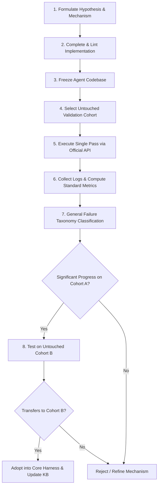

# EVALUATION PROTOCOL: RIGOROUS, FROZEN & ANTI-OVERFITTING BENCHMARKING

## 1. Core Principles & Philosophy
In ARC-AGI-3, local metrics are deceptive. Any agent designed by inspecting source files, hardcoding color-role assumptions, or tuning on evaluation games will inevitably fail on Kaggle's 110 hidden games.

Progress is defined strictly as:
> **An improvement in task completion rate, RHAE, and sample efficiency on a completely untouched, held-out cohort of environments whose code, metadata, and visuals have never been inspected by human or agent.**

---

## 2. Held-Out Cohort Architecture

### 2.1 Game Partitioning
The local repository hosts 252 environments in `arc-interactive/environment_files`.
To ensure zero data contamination, games are partitioned into strict cohorts:

| Cohort | Games | Purpose | Rules |
| :--- | :--- | :--- | :--- |
| **Cohort 0: Smoke Test** | 5 games (e.g. `ls20`, `sk01`) | Fast pipeline & sanity check (<30s). | Run frequently to verify basic execution. |
| **Cohort 1: Development / Diagnostic** | 20 games | Architectural tuning, debugging general mechanics. | Permitted for error analysis, provided fixes are mechanism-level. |
| **Cohort 2: Held-Out Validation A** | 25 games | Primary frozen benchmark for validating hypotheses. | **Zero source inspection.** Run once per experiment. |
| **Cohort 3: Held-Out Validation B (Fresh Reserve)** | 25 games | Secondary confirmation benchmark. | Run ONLY after an experiment succeeds on Cohort 2. |
| **Cohort 4: Sealed Leaderboard Reserve** | Remaining ~177 games | Kept completely untouched for pre-submission sweeps. | Never opened or evaluated during daily cycles. |

---

## 3. The Frozen Evaluation Protocol (Step-by-Step)

Before claiming any architectural or algorithmic improvement, the following 10-step protocol must be strictly observed:

### Detailed Steps:
1. **Hypothesis Formulation:** Explicitly state the general capability being enhanced (e.g., "Active boundary probing reduces wall-induction actions from 18 to 4").
2. **Code Implementation:** Build general, game-agnostic mechanisms.
3. **Agent Freeze:** Commit all changes to git. No modifications are permitted during the benchmark run.
4. **Cohort Selection:** Select a designated untouched cohort.
5. **Single-Pass Execution:** Run the benchmark once using `evaluate_all_public_dataset.py`.
   - No reruns.
   - No runtime adjustments or manual interventions.
6. **Metric Aggregation:** Extract win rate, levels cleared, actions spent, official score, RHAE, and wall-clock execution time.
7. **Failure Diagnosis:** Categorize all incomplete games using the standardized `FAILURE_TAXONOMY.md` categories.
8. **Transfer Verification:** If results improve on Cohort A, run immediately on fresh Cohort B.
9. **Decision Gate:** Adopt the change only if it demonstrates statistically meaningful transfer without regressions.
10. **Knowledge Base Update:** Log the full trial in `EXPERIMENT_LOG.md`.

---

## 4. Standard Metrics & Mathematical Definitions

Every experiment must record and report these 7 metrics:

1. **Win Rate ($W$):**
   $$W = \frac{\sum_{k=1}^N \mathbb{I}(\text{game } k \text{ is WON})}{N} \times 100\%$$
2. **Level Completion Efficiency ($L_{comp}$):**
   $$L_{comp} = \frac{\sum_{k=1}^N \text{levels\_completed}_k}{\sum_{k=1}^N \text{win\_levels}_k} \times 100\%$$
3. **Mean Official Score ($\bar{S}_{off}$):**
   $$\bar{S}_{off} = \frac{1}{N} \sum_{k=1}^N \text{official\_score}_k \quad (\text{Scale } 0.0 - 115.0\%)$$
4. **Mean Relative Human Action Efficiency ($\bar{R}_{HAE}$):**
   $$\bar{R}_{HAE} = \frac{1}{N} \sum_{k=1}^N \text{RHAE}_k \times 100\%$$
5. **Mean Actions Per Cleared Level ($\bar{A}_{lvl}$):**
   $$\bar{A}_{lvl} = \frac{\text{Total Actions on Cleared Levels}}{\text{Total Levels Cleared}}$$
6. **Execution Time Per Game ($\bar{T}_{game}$):**
   $$\bar{T}_{game} = \frac{\text{Total Benchmark Wall-Clock Time}}{N} \quad (\text{seconds})$$
7. **Token Budget Per Action ($\bar{\tau}_{act}$):**
   $$\bar{\tau}_{act} = \frac{\text{Total Autoregressive Tokens}}{\text{Total Actions Taken}}$$

---

## 5. Anti-Overfitting & Anti-Cheating Checklist

Before logging any experiment as valid progress, verify every item:

- [ ] **No Source Peeking:** No agent or developer opened, read, or parsed any file in `arc-interactive/environment_files/<game_id>/`.
- [ ] **No Game ID Branching:** Code contains zero checks like `if game_id == "..."` or string matches on game names.
- [ ] **No Coordinate Fingerprinting:** Code contains no hardcoded coordinates for player spawns, buttons, doors, or HUD positions.
- [ ] **No Color Role Assumptions:** No hardcoded assumptions that color 0 is background, color 1 is player, or color 2 is wall. All roles must be inferred dynamically.
- [ ] **Single Pass Execution:** The benchmark was run exactly once without cherry-picking seeds or rerunning failed games.
- [ ] **Cohort Independence:** The evaluation cohort was not used in any way to formulate or tune the mechanism.
- [ ] **Reproducible Script:** Evaluation was performed using standard CLI commands and committed configuration.
