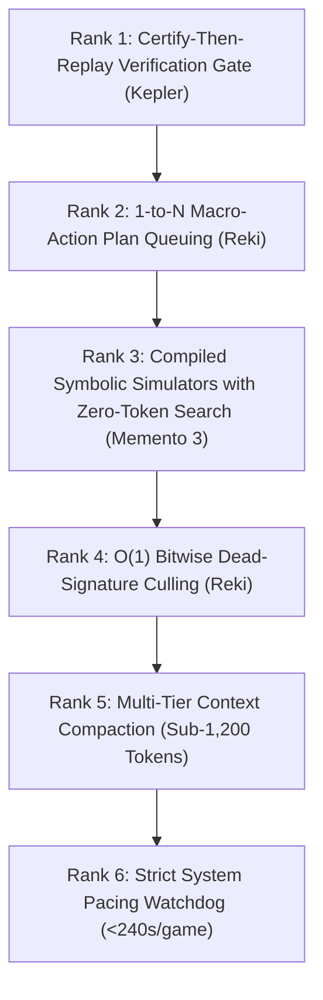

# RESEARCH & COMPETITIVE LANDSCAPE: ARC PRIZE 2026 (ARC-AGI-3)

## 1. Executive Summary: The Leaderboard Transfer Reality

ARC-AGI-3 marks a fundamental transition from static grid puzzles (ARC-AGI-1/2) to **interactive, turn-based fluid intelligence**. Agents interact with unfamiliar, black-box 2D environments (64×64 grids, 16-color palettes) with zero natural-language instructions, no stated goals, and no predefined action semantics.

### The Grand Transfer Gap: Public 100% vs. Leaderboard 1.21%
A critical discovery in ARC-AGI-3 research is the massive gulf between local/public performance and the official Kaggle Leaderboard:
- Academic frontier systems (Kepler, Memento 3) achieved **100.00 RHAE** across all 25 public demo games using heavy frontier models (Claude Opus 5, GPT-5) and prompt caching. However, this required **858M tokens** and **$777 in API compute**—completely impossible inside Kaggle's offline sandbox.
- Under Kaggle's strict competition constraints (9 hours offline across 110 hidden games, dual T4 or single RTX 6000), the **winning Milestone 1 score was 1.21%** (Tufa Labs' *The Duck*), followed by **~1.05%** (Team Reki).
- **The Core Lesson:** Never optimize for the 25 public games. True fluid intelligence requires fast, sample-efficient rule induction that executes under strict per-game runtime ($<4.9$ min/game) and token budgets.

---

## 2. In-Depth Profiles of Top Solutions & Contenders

### 2.1 Tufa Labs — "The Duck" (1st Place Milestone 1 Winner — $25,000)
- **Authors:** Harold Bessis, Jeroen Cottaar, Isaiah Pressman, Andries Smit, Michal Tešnar, Stefano Viel.
- **Base Model & Quantization:** **Qwen 3.6 27B in FP8** (deployed via vLLM on Kaggle).
- **Inference Engine:** **vLLM** offline server (`taaf-duck-harness-kaggle-share`).
- **Core Architecture:**
  - Built on **TAAF** (*Tufa ARC-AGI Framework*), treating ARC-AGI-3 as an **interactive coding problem** using a live Python REPL.
  - Game states are converted into Python variables. The LLM writes Python scripts to inspect arrays, compute flood-fills, test hypotheses, and execute game actions (`step()`).
- **Memory Management:** **"Infinite Play via Message Eviction"**—a sliding-window protocol where older dialogue turns are evicted while system prompts and recent action history are preserved.
- **Official Score:** **1.21% on Kaggle Milestone 1 Leaderboard**.
- **Failure Modes:** REPL syntax/runtime crashes; infinite script loops; context amnesia when eviction drops early discoveries; prompt overfitting tuned around public game idioms.

---

### 2.2 Team Reki (2nd Place Milestone 1 Winner — $7,500)
- **Base Model & Quantization:** **Gemma-4-31B in FP8 / AWQ** via vLLM.
- **Core Architecture: "Vision-LLM-as-Policy" with Micro-Action Queues**:
  - Ingests labeled image frames with coordinate ticks.
  - LLM outputs a single structured JSON payload containing:
    1. `"what_changed"`: Visual frame diff analysis.
    2. `"plan"`: Short natural-language rationale.
    3. `"action_queue"`: An array of **1 to 4 sequential actions**.
- **Action Batching Advantage:** Emitting 1–4 actions per LLM call cuts token consumption and inference latency by **~60%**, preserving trajectory momentum.
- **Memory & Toolsuite:**
  - **Episodic Reflection Memory:** Summarizes progress and active hypotheses every ~10 steps.
  - **Dead-Signature Detector:** Prunes repeated futile actions (e.g. walking into a solid wall).
  - **NumPy Click-Heuristic Fallback:** Explores small rare-colored components on Level 1 without spending GPU inference.
- **Official Score:** **~1.05% on Kaggle Milestone 1 Leaderboard**.
- **Failure Modes:** Spatial coordinate hallucination on 64×64 grids; heuristic bias failing on non-button games; dead-signature false positives.

---

### 2.3 Kepler & Tycho (NIMI-Research / Wensen Wu, arXiv:2610.00834)
- **Core Paradigm:** **Auditable World Models & Certify-Then-Replay Protocol**.
- **Base Model:** Frozen Claude Opus 5 / GPT-5.6 Sol / open-weight models.
- **Architecture:**
  - Does not emit raw environment actions directly.
  - Maintains an explicit Python world model (`world_model.py`), research notes (`notes.md`), and an append-only transaction ledger (`events.jsonl`).
  - Hypotheses are formalized as **Deterministic Moore Machines**.
- **Dual Verification Gates:**
  1. *Retrospective Transition Checks:* A candidate world model must reproduce 100% of historical recorded transitions in `events.jsonl`.
  2. *Predictive State Checks:* Before taking a live step, the world model must predict $S_{t+1}$. If actual $S_{t+1}$ diverges, execution halts and triggers model revision.
- **Planning:** BFS/A* pathfinding executes *inside* the verified world model; verified trajectories are committed in batch via `freecommit.py`.
- **Public Performance:** **100.00 RHAE** across all 25 public demo games (181/183 levels completed with median-human efficiency).
- **Critical Limitation:** Consumed **858M tokens** and **$777 in API compute**—infeasible for Kaggle's 9-hour offline sandbox unless distilled into a compact local model.

---

### 2.4 Memento 3 (Huawei Noah's Ark Lab & UCL, arXiv:2610.11794)
- **Core Paradigm:** **Model-Based Recursive Self-Improvement through Reflective Rulebooks**.
- **Base Model:** Frozen Claude Opus / frontier coding models.
- **Memory & Planning:**
  - Maintains a natural-language markdown document (`rulebook.md`) detailing working hypotheses of physics, affordances, and win conditions.
  - Compiles the rulebook into an executable Python simulator (`simulator.py`).
  - Standard pathfinding algorithms (BFS, Dijkstra, A*) plan inside the simulator. **Zero LLM tokens are burned during search.**
- **Dual Verification Gates:** Semantic alignment audit + cell-exact replay verification across all historical frames.
- **Public Performance:** **100.00 RHAE** across all 25 public games, using only **44% of human action counts**.
- **Failure Modes:** High compilation latency scaling quadratically with history length; brittle on noisy/stochastic environments.

---

### 2.5 Barada Sahu (Kaggle Leaderboard Rank 3 Contender)
- **Core Focus:** Extreme action-budget efficiency, aggressive loop pruning, and low-latency local inference.
- **Key Mechanism:** Balances fast rule-based action generation during routine states with targeted LLM intervention only when novel transitions or dead ends occur, preserving Kaggle runtime across all 110 games.

---

## 3. Comprehensive Architectural Comparison Matrix

| Dimension | Tufa Labs (The Duck) | Team Reki | Kepler / Tycho (NIMI) | Memento 3 (Huawei/UCL) | Project Override / Singularity |
| :--- | :--- | :--- | :--- | :--- | :--- |
| **Competition Standing** | **1st Place Milestone 1** | **2nd Place Milestone 1** | Academic SOTA (Public) | Academic SOTA (Public) | Active Development |
| **Base Model** | Qwen 3.6 27B (FP8) | Gemma-4-31B (FP8) | Claude Opus 5 / GPT-5.6 | Claude Opus (Frozen) | **Qwen 2.5 14B / 32B (Q4_K_M)** |
| **Inference Engine** | vLLM (Offline) | vLLM (Offline) | Cloud API / Local vLLM | Cloud API | **llama.cpp / vLLM (Dual T4)** |
| **Agent Paradigm** | REPL-Centric Coding | Vision-LLM Policy | Auditable World Model | Reflective Rulebook | **Neurosymbolic World Model** |
| **Observation Format** | Image + ASCII + Crops | Labeled PNG Images | Moore Machine State | Markdown + Grid | **Symbolic Entity Graph + ASCII** |
| **Memory Strategy** | Sliding Window Eviction | Episodic Reflections | Append Ledger (`events.jsonl`)| Markdown `rulebook.md` | **Multi-Tier Semantic Memory** |
| **Planning Engine** | LLM Code Generation | 1–4 Action Queue | BFS/A* in Python Model | BFS/A* in Compiled Sim | **Macro-Action Queue (A*/BFS)** |
| **Verification Gate** | None (Trial-and-Error) | Legal Action Filter | Retrospective + Predictive | Replay Exact + Semantic | **Verification Delta ($S \oplus \hat{S}$)** |
| **Public Score** | $\approx 1.60$ | $\approx 1.40+$ | **100.00 RHAE** | **100.00 RHAE** | **34.62% Official / 35.24% RHAE** |
| **Leaderboard Score** | **1.21%** (Official LB) | $\approx 1.05\%$ (Official LB) | N/A (Cloud Compute) | N/A (Cloud Compute) | **Target: Leaderboard Win** |
| **Kaggle Feasibility** | Proven (Milestone 1) | Proven (Milestone 1) | Infeasible as-is | Infeasible as-is | **Optimized for 9h Dual T4** |

---

## 4. The Five Root Causes of the Transfer Collapse

1. **Bimodal Game Failure ("The Zero Trap"):**  
   Games in ARC-AGI-3 are bimodal: an agent either infers the rule and clears all levels in $<20$ actions, or fails to deduce the goal and exhausts its budget at score 0. A small drop in rule induction rate on novel mechanics causes a catastrophic drop on the leaderboard.
2. **Visual & Semantic Overfitting:**  
   Reki's button-click heuristic and Duck's prompt idioms overfit to public game types. Hidden evaluation games feature completely novel mechanics (gravity, reflection symmetry, fluid flow, topological color fills).
3. **Compute Starvation under Kaggle Deadlines:**  
   Kepler required 858M tokens for 25 games. Kaggle allows only 9 hours total for 110 games ($\approx 4.9$ minutes per game). Heavy iterative prompting triggers timeouts.
4. **Context Amnesia & Loop Traps:**  
   Sliding-window eviction discards early affordance discoveries, causing the agent to repeatedly test known-dead actions.
5. **Blind Action Commits:**  
   Committing exploratory actions directly to the real environment creates irreversible traps (e.g. pushing a box into a corner or falling into hazards).

---

## 5. Ranked Game-Agnostic Transferable Mechanisms

Based on cross-analysis of all winning systems, here is the prioritized hierarchy of transferable mechanisms:

### Rank 1: Certify-Then-Replay Verification Gate (Kepler)
Maintain an explicit internal Python world model. Before committing any action:
1. *Backtest:* Verify the model reproduces 100% of historical recorded transitions.
2. *Predict:* Simulate the next step; compare predicted vs actual frame.
*Why it transfers:* Operates purely on mathematical consistency, completely agnostic to visual themes or colors.

### Rank 2: 1-to-N Macro-Action Plan Queuing (Reki)
Instead of invoking the LLM every single step, the planner outputs a coherent queue of 1 to 4 actions.
*Why it transfers:* Drastically cuts inference latency and token costs by $50\%\text{--}75\%$, preserves multi-step goal momentum, and vastly improves RHAE on routine steps.

### Rank 3: Dual Semantic Memory + Compiled Simulator (Memento 3)
Decouple reasoning into two tiers:
- Tier 1: Natural-language markdown rulebook (`rulebook.md`) documenting object roles, affordances, and hypotheses.
- Tier 2: A fast Python script compiled from the rulebook that runs algorithmic pathfinding (BFS/A*).
*Why it transfers:* Allows zero-token, lightning-fast planning for routine movement while reserving expensive LLM calls exclusively for hypothesis updates when unexpected transitions occur.

### Rank 4: Dead-Signature Loop Breaking & Action Masking (Reki / Kepler)
Track a hash of $(S_t, a_t) \to S_{t+1}$. If an action produces a null transition ($\Delta S = 0$) or returns to an identical state cycle, permanently prune that action from that state signature.
*Why it transfers:* Prevents the #1 failure mode on unseen games: infinite repetition loops that exhaust the action budget.

### Rank 5: Multi-Representation Perception with Dynamic Cropping (The Duck)
Provide the model with both coordinate-aligned ASCII matrices and dynamic bounding-box crops of active sub-regions.
*Why it transfers:* Overcomes the spatial blindness of pure text grids while avoiding the coordinate hallucination of downsampled 64×64 vision models.

### Rank 6: Strict Action-Budget Management & Fast Failure Cutoffs (Barada Sahu / Duck)
Implement strict per-game time and action budgets ($\le 5$ minutes, $\le 60$ exploratory probes). If an agent shows zero progress or score increase within the exploratory window, terminate gracefully and save budget for solvable games.
*Why it transfers:* Prevents bimodal "score-zero sinkholes" from depleting the 9-hour Kaggle runtime budget across the 110 evaluation games.
