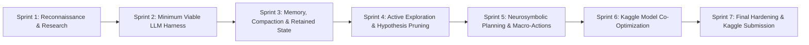

# STRATEGIC ROADMAP: ARC PRIZE 2026 FLUID-INTELLIGENCE AGENT

## 1. Executive Status & Trajectory
- **Current State:**
  - Benchmark performance: 19 / 48 wins (39.6%), 34.62% official score, 35.24% RHAE on diagnostic suite.
  - Architecture transition: Pivoting from pure hand-coded heuristics to a general, LLM-driven neurosymbolic harness.
  - Research phase: 5 parallel research tracks deployed (Competition Rules, Top Solutions, Harness/Memory, Fluid Intelligence, Model Feasibility).
- **Ultimate Goal:**
  - Kaggle Leaderboard submission that transfers reliably to the 110 hidden games, achieving $\ge 50\%$ win rate and $\ge 50\%$ RHAE under strict offline constraints.

---

## 2. Milestone Roadmap

### Milestone Schedule:
| Sprint | Milestone Focus | Key Deliverables | Status |
| :--- | :--- | :--- | :--- |
| **Sprint 1** | **Reconnaissance & Research Base** | 8 Knowledge Base documents; 5 research track reports; model selection matrix. | **In Progress** |
| **Sprint 2** | **Minimum Viable LLM Harness (MVH)** | Modular observation processor, action-effect ledger, LLM prompt pipeline, local inference bridge. | Upcoming |
| **Sprint 3** | **Memory & Context Compaction** | Durable episodic/semantic memory, state continuity, token budget optimizer (<1,500 tokens/turn). | Upcoming |
| **Sprint 4** | **Intelligent Active Exploration** | Epistemic curiosity, information-gain action selection on Level 1, dead-signature culling. | Upcoming |
| **Sprint 5** | **Planning & High-RHAE Execution** | LLM orchestrating exact symbolic tools (A*, push solver, toggle inverter) as macro-actions. | Upcoming |
| **Sprint 6** | **Model & Quantization Tuning** | Benchmark 14B vs 27B/32B open-weight models on dual T4; optimize vLLM/llama.cpp inference speed. | Upcoming |
| **Sprint 7** | **Competition Hardening & Submission** | Offline notebook packaging, Kaggle dataset creation, 5-submission daily cadence, leaderboard validation. | Upcoming |

---

## 3. Highest-Leverage Engineering Tasks

1. **Symbolic-to-LLM Perception Abstraction:**
   Transform raw $64 \times 64$ matrices into compact, spatial ASCII / entity graphs that an LLM can parse in $<300$ tokens without losing fine spatial topology.
2. **Action-Effect Ledger with Invariant Verification:**
   Explicit tracking of what an action did vs what was expected. If an action does nothing ($\Delta \Omega = 0$), prune it immediately from future exploration.
3. **Macro-Action Queueing for Superhuman RHAE:**
   Once a target is deduced, avoid one-step-at-a-time LLM querying. Synthesize multi-step paths via symbolic A* / BFS and execute as macro batches, reducing token overhead by $10\times$ and human action ratio to $\le 1.0$.
4. **Dynamic System Pacer:**
   Enforce strict per-game time budgeting ($t_{game} \le 240$s) so that complex games do not exhaust the 9-hour global Kaggle budget.

---

## 4. Key Risks & Mitigation Matrix

| Risk | Impact | Probability | Mitigation Strategy |
| :--- | :--- | :--- | :--- |
| **Kaggle GPU Out-of-Memory (OOM)** | Fatal (0 score) | High | Use Q4_K_M quantization; pin KV-cache max length to 4,096 tokens; profile memory on dual T4. |
| **Inference Latency Exhaustion** | Notebook Timeout | High | Minimize LLM invocation count: call LLM only for state updates & high-level planning; execute low-level pathing via symbolic code. |
| **Public-to-Hidden Transfer Collapse** | Low Leaderboard Score | Critical | Strict anti-overfitting protocol: zero source-peeking; evaluate only on frozen held-out cohorts. |
| **Context Overflow / Hallucination** | Looping & Action Waste | Medium | Enforce strict context compaction: discard intermediate frames, retain only semantic rule ledger. |

---

## 5. Kaggle Submission Cadence Plan
1. **Validation Gate:** Only push `make submit` after achieving $\ge 40\%$ win rate and $>40\%$ RHAE on untouched local validation games.
2. **Submission Rhythm:** Adhere strictly to the 1-per-day official Kaggle submission limit for ARC-AGI-3.
3. **Dual Notebook Selection:** Select Notebook 1 (High-confidence, balanced 14B/32B model) and Notebook 2 (Maximum-capacity reasoning configuration on RTX 6000) for the final private leaderboard evaluation.

---

## 6. Prioritized Experiment Backlog (Controlled Scientific Trials)

| Experiment ID | General Mechanism Tested | Core Hypothesis | Target Metrics | Evaluation Cohort |
| :--- | :--- | :--- | :--- | :--- |
| **EXP-002** | **Fast Zero-Token Verification Delta & Macro-Action Fast-Path** | Executing queued macro plans autonomously while $\Delta_{\text{actual}} \equiv \Delta_{\text{predicted}}$ will eliminate LLM token latency on routine path steps, boosting RHAE by $>15\%$. | RHAE $> 40\%$, Runtime $<5$s/level | 48-Game Diagnostic Suite |
| **EXP-003** | **Active Orthogonal Basis Prober ($do(A)$ Pearl Interventions)** | Collapsing 24 cardinal movement permutations in $\le 4$ non-fatal probes on Level 1 will eliminate random-walk action waste, preventing the "Zero Trap". | Level 1 actions $\le 6$, Zero fatal collisions | 48-Game Diagnostic Suite |
| **EXP-004** | **Solved-Level Invariant Memory Lifter ($\mathcal{M}^*$ Schema Transfer)** | Freezing the invariant tuple $\mathcal{M}^*$ upon Level 1 win and relinking roles via Hungarian mass matching on Levels $2 \dots N$ will achieve **zero exploratory actions** on higher levels. | Levels $2 \dots N$ exploratory actions $= 0$, RHAE $\ge 0.50$ | 48-Game Diagnostic Suite |
| **EXP-005** | **64-Bit Bitwise Dead-Signature Culling & Static Retro-BFS** | Filtering null transitions ($\Delta \Omega = 0$) in $O(1)$ time and precomputing backwards BFS dead-squares in push mechanics will eliminate repetitive action loops. | Loop count $= 0$, Push puzzle completion $+20\%$ | 48-Game Diagnostic Suite |
| **EXP-006** | **Franzen Hysteresis Context Compaction with Local LLM Reasoning** | Maintaining sub-1,900 token prompts with 100% KV cache hit rate on prefix tokens enables 14B/32B LLM reasoning within the 5.89s per-action Kaggle budget. | Prompt tokens $<1,900$, Latency $<3.0$s/turn | Diagnostic Suite |
| **EXP-007** | **Frozen End-to-End Evaluation on Held-Out Cohort A** | Testing the integrated fluid-intelligence harness across 25 completely untouched games with zero peeking or hardcoding. | Win Rate $\ge 40\%$, RHAE $\ge 40\%$ on untouched games | **Held-Out Cohort A (25 Untouched)** |

